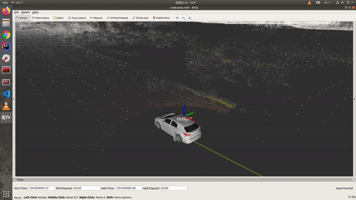
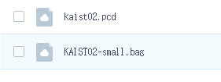
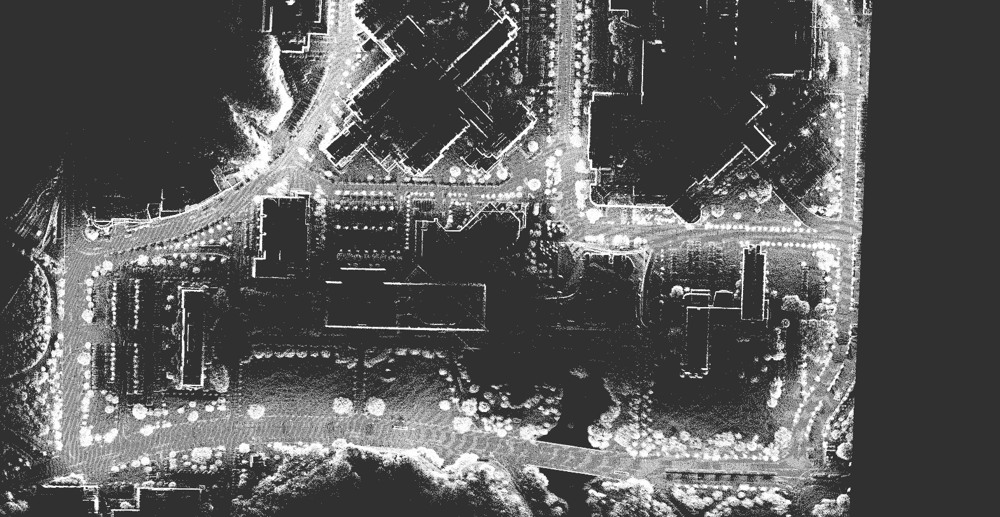
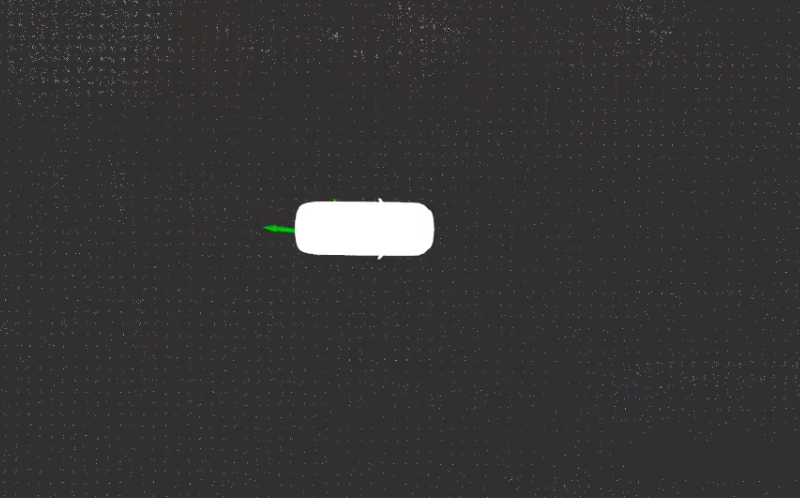
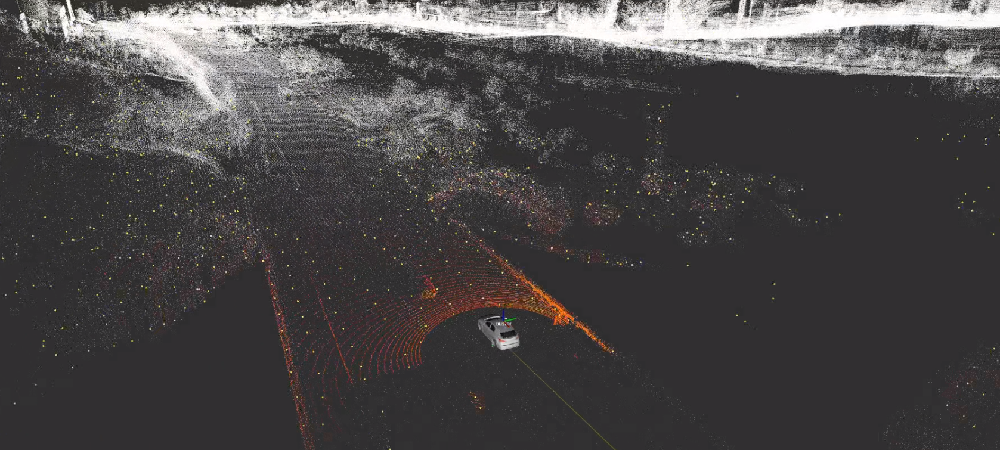

# NDT Localizer
## 一个干净且简单的 NDT 定位器

这个仓库是从 Autoware 的 lidar_localizer 模块修改而来的。与 Autoware 中的模块相比，这个仓库干净、简单且没有依赖其他包（你不需要编译 Autoware 项目中的所有包）。你只需要 ROS 和一个 pcd 文件（点云地图）。

让我们从这个简单的仓库开始学习基于 LiDAR 的定位吧！

## 在点云地图（pcd）中进行定位


在 MulRan 数据集上的演示视频：

[](https://www.youtube.com/watch?v=qhqDmmO7c4c)

## 如何使用

### 准备你的 pcd 地图和 rosbag

你可以按照我的博客 [基于NDT的自动驾驶高精度定位和ROS项目实战](https://blog.csdn.net/AdamShan/article/details/106739856?spm=1001.2014.3001.5501) 和 [使用SC-LEGO-LOAM进行较大规模点云地图构建和闭环优化](https://blog.csdn.net/AdamShan/article/details/106589633?spm=1001.2014.3001.5501) 使用 Mulran 数据集来构建你的 pcd 地图并生成点云数据。不幸的是，这些博客是用中文写的，如果你看不懂中文博客并且想复现项目演示，可以使用下面的链接（百度网盘）下载 pcd 地图和 rosbag：

链接: https://pan.baidu.com/s/1hZ0VuQCy4KX3lHUTFdVeww 密码: r7fl



> KAIST02-small.bag 不是完整的 KAIST02 数据集，因为 rosbag 没有压缩数据，完整的 KAIST02 rosbag 太大了。所以我使用 KAIST02 数据集的前 81 秒制作了这个小 rosbag。

将 pcd 数据放到 map 文件夹中：

```bash
cp kaist02.pcd map/
```

### 在你的 ros 工作空间中构建
将这个仓库克隆到你的 `ros workspace/src/` 中，然后 `catkin_make`（或 `catkin build`）：
```bash
cd catkin_ws/src/
git clone https://github.com/AbangLZU/ndt_localizer.git
cd ..
catkin_make
```

### 设置配置

#### 配置地图加载器
将你的地图 pcd 文件（.pcd）移动到这个项目的 map 文件夹中（`ndt_localizer/map`），将 `map_loader.launch` 中的 pcd_path 修改为你的 pcd 路径，例如：

```xml
<arg name="pcd_path"  default="$(find ndt_localizer)/map/kaist02.pcd"/>
```
#### 配置点云下采样

在 `launch/points_downsample.launch` 中配置你的 LiDAR 点云话题：

```xml
<arg name="points_topic" default="/os1_points" />
```

如果你的 LiDAR 数据稀疏（如 VLP-16），你需要在 `launch/points_downsample.launch` 中配置较小的 `leaf_size`，例如 `2.0`。如果你的 LiDAR 点云密集（如 VLP-32、Hesai Pander40P、HDL-64 等），保持 `leaf_size` 为 `3.0`。

#### 配置静态 tf

这个项目中有两个静态变换：`base_link_to_localizer` 和 `world_to_map`，如果你使用不同的 LiDAR，请将 `ouster` 替换为你的 LiDAR 帧 ID：

```xml
<node pkg="tf2_ros" type="static_transform_publisher" name="base_link_to_localizer" args="0 0 0 0 0 0 base_link ouster"/>
```

#### 配置 ndt 定位器
你可以在 `ndt_localizer.launch` 中配置 NDT 参数。NDT 算法的主要参数是：

```xml
<arg name="trans_epsilon" default="0.05" doc="两次连续变换之间的最大差异，以考虑收敛" />
<arg name="step_size" default="0.1" doc="牛顿线搜索最大步长" />
<arg name="resolution" default="2.0" doc="ND 体素网格分辨率" />
<arg name="max_iterations" default="30.0" doc="计算对齐所需的迭代次数" />
<arg name="converged_param_transform_probability" default="3.0" doc="" />
```

这些默认参数适用于 64 和 32 线 LiDAR。

### 运行定位器
一旦你准备好 pcd 地图和配置，运行定位器：

```bash
# 打开一个 roscore
roscore
# 在其他终端
cd catkin_ws
source devel/setup.bash
# 如果你在播放 rosbag，使用 rosbag 模拟时间!!!
rosparam set use_sim_time true
# 启动 ndt_localizer 节点
roslaunch ndt_localizer ndt_localizer.launch
```

等待几秒钟加载地图，然后你可以在 rviz 中看到你的 pcd 地图：



在 rviz 中给当前车辆一个初始姿态（2D Pose Estimate）：



这个操作会发送一个初始姿态到话题 `/initialpose`。

播放 rosbag：

```bash
rosbag play KAIST02-small.bag --clock
```

然后你会看到定位结果：



最终的定位消息会发送到 `/ndt_pose` 话题：

```proto
---
header: 
  seq: 1867
  stamp: 
    secs: 1566536121
    nsecs: 251423898
  frame_id: "map"
pose: 
  position: 
    x: -94.8022766113
    y: 544.097351074
    z: 42.5747337341
  orientation: 
    x: 0.0243843578881
    y: 0.0533175268768
    z: -0.702325920272
    w: 0.709437048124
---
```

定位器还会发布一个 `base_link` 到 `map` 的 tf：

```
---
transforms: 
  - 
    header: 
      seq: 0
      stamp: 
        secs: 1566536121
        nsecs: 251423898
      frame_id: "map"
    child_frame_id: "base_link"
    transform: 
      translation: 
        x: -94.8022766113
        y: 544.097351074
        z: 42.5747337341
      rotation: 
        x: 0.0243843578881
        y: 0.0533175268768
        z: -0.702325920272
        w: 0.709437048124
```

### 想了解更多细节？
你可以关注我在 CSDN 的博客系列（中文）：https://blog.csdn.net/adamshan